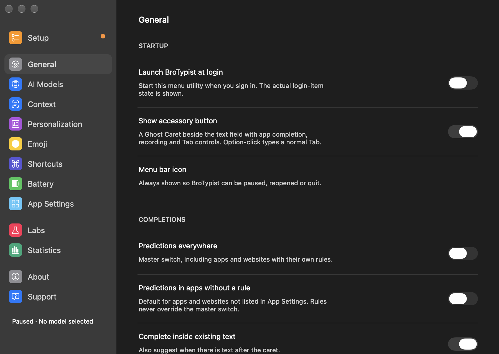

<h1 align="center">
  <picture>
    <source media="(prefers-color-scheme: dark)" srcset="docs/brand/brotypist-lockup-dark.svg">
    <source media="(prefers-color-scheme: light)" srcset="docs/brand/brotypist-lockup-light.svg">
    
  </picture>
</h1>

<p align="center"><strong>Predictive typing that stays on your computer.</strong></p>
<p align="center">
  <a href="https://github.com/renan-brasilio/brotypist/releases">Downloads &amp; release notes</a> ·
  <a href="#install">Install</a> ·
  <a href="#use-brotypist">Usage</a> ·
  <a href="#privacy">Privacy</a> ·
  <a href="#develop">Develop</a>
</p>

BroTypist suggests the next words beside your cursor, in the apps you already
use. Accept what fits, dismiss what doesn't, and keep writing—without moving
your draft into a chatbot. It lives in the menu bar or system tray, with
OS-native Settings and local model inference.

**Native Rust, with macOS first.** **0.5.2 is the macOS-only stable release
channel; Windows and Linux remain ALPHA.** Publication follows final signed
package verification; use assets actually listed in
[Releases](https://github.com/renan-brasilio/brotypist/releases).
The Mac update improves responsiveness and editor compatibility, removes raw
debug text from Setup, and retains downloaded models in durable app data.
Model relevance and text-field compatibility still vary: stable does not mean
every app is supported or establish three-platform parity. The
[migration and acceptance record](docs/rust-migration/README.md) separates
source-bound observations from final release proof and remaining platform gates.

## Writing, with you in control

- **Inline completion.** Grey text on the same line, with next-word or full
  acceptance and configurable shortcuts. No popup substitute for unsupported fields.
- **Your languages and model.** Brazilian Portuguese, English and mixed-language
  prompts; choose a local GGUF model or import a compatible one.
- **Emoji without inference.** Explicit `:name` and emoticon suggestions from a
  local catalogue, where the target safely supports replacement.
- **Context by choice.** Separate opt-ins for window text, clipboard and
  screenshot context, plus per-app rules and writing instructions.
- **Optional local personalization.** Encrypted writing history can help reuse
  vocabulary and style; it does not retrain model weights.
- **A resident utility.** Quick pause, battery-aware inference, model unloading
  and native controls rather than another writing window.

<p align="center">
  
</p>
<p align="center"><sub>Actual native macOS Settings, captured in an owned disposable profile—not a mockup or a personal conversation. <a href="evidence/rust-migration/macos-gui-status/receipt.json">Capture record</a>.</sub></p>

## Platform support

| Platform | Current native status | Installation |
| --- | --- | --- |
| **macOS 15+, Apple Silicon** | **0.5.2 stable channel.** AppKit Settings; responsiveness and bounded editor compatibility improvements. Compatibility varies by text field. | Mac-only DMG/ZIP when listed in Releases; Apple Development signed, **not notarized**. |
| **Linux x86-64, X11** | **ALPHA.** Packaging, inference and native UI have evidence; desktop typing compatibility is limited. Emoji/synonym/typo rewrites are unavailable. | Alpha DEB or portable test bundle when supplied; not part of the macOS stable release. |
| **Linux x86-64, Wayland** | **ALPHA. Ordinary inline completion is unavailable.** Manual preview only; experimental KDE input-method controls require explicit selection and are not general inline support. | Alpha test bundles; installation does not enable an input method. |
| **Windows x86-64** | **ALPHA.** Unsigned portable testing; inference and owned-window GUI checks do not establish full physical typing, upgrade or rollback acceptance. **MSI distribution is held.** | Authorized portable test bundle only; not part of the macOS stable release. |

**Not every text field is supported.** BroTypist needs reliable focus, text,
caret geometry and insertion information. Password fields, active text
composition and unsafe or unobservable targets are excluded. It stays silent
rather than placing a completion in the wrong place. See
[compatibility evidence](evidence/VERIFICATION.md) and the
[native acceptance register](docs/rust-migration/parity.md).

On macOS, Electron/Chromium controls with unreliable replacement setters support
ordinary completion only when safe inline geometry is available. Emoji,
synonym and typo replacement are disabled in those append-only controls.

For the macOS VS Code compatibility path in 0.5.1, code-editor completions remain
an explicit per-app opt-in. VS Code 1.144's native EditContext backend does not
expose reliable caret/glyph geometry. The verified native geometry path requires
`"editor.accessibilitySupport": "on"` and `"editor.editContext": false` in VS Code.
These change its accessibility/input mode; BroTypist does not silently apply them.
Its textarea relay is clipped to the verified native editor viewport, not its
one-point input element. Direct Cursor verification is still pending.

Copilot and Cursor Tab also draw grey inline text and accept with Tab. Use one
automatic inline provider in a given editor rather than assuming their overlays
and shortcuts coordinate. BroTypist does not disable either assistant.
WordCraft 0.13.2's advertised accessibility setter did not change the owned test
document; BroTypist keeps that unverified editing target excluded.

## Install

Use only assets actually listed for your platform in
[Releases](https://github.com/renan-brasilio/brotypist/releases), or an explicitly
supplied preview bundle. Check the package's release notes and included
`SHA256SUMS`; a CI artifact is not automatically a released installer.

### macOS

1. Quit any running copy. Open the DMG, drag **BroTypist.app** into
   **Applications**, then open it there.
2. Grant **Accessibility / Device Control and Data Access** and **Input
   Monitoring** in System Settings → Privacy & Security. Setup shows their status.
3. Choose a model in Welcome and try the prediction preview. Gemma 4 E2B needs
   about **2.84 GB** of disk space for weights; smaller options are available.
   Models download separately.
4. Enable predictions for the apps you want to use, then type in a supported field.

Current Mac packages are Apple Development signed, **not notarized**. If macOS
blocks a verified download, use the app-specific **Open Anyway** action in
Privacy & Security. Do not disable Gatekeeper globally. Screen Recording is
needed only for optional screenshot features.

Downloaded models are retained outside the app bundle, so an app update does
not require downloading them again. Startup verifies selected primary and battery
catalog models from the old default cache before retaining missing weights in
durable app data. Original weights and custom model paths are preserved.

### Linux ALPHA

For a supplied DEB on Ubuntu 24.04+/Debian 13+:

```sh
sudo apt install ./BroTypist-<version>-linux-amd64.deb
brotypist
```

On Arch/CachyOS, extract the portable archive and run `./launch-brotypist` from
its directory. Keep the entire bundle together and run as your desktop user,
**not root**. Packaged inference requires AVX2/FMA/F16C CPU support. On Wayland,
use the manual preview; do not change session environment variables to pretend
the session is X11.

### Windows ALPHA — portable testing

Extract the supplied ZIP into a user-writable folder, keep all bundled DLLs
together, and launch `BroTypist.exe`. The preview is **unsigned**; do not disable
Windows security controls to run it. MSI installation remains held pending the
installer acceptance gates.

## Use BroTypist

- **Complete:** type normally in a supported field. **Tab** accepts the next
  word; **Escape** dismisses. Configure full acceptance and other bindings in
  **Settings → Shortcuts**.
- **Find emoji:** in a replacement-capable field, type `:sweat_smile` or
  `:sorriso` at the start of a line or after a space. A closing `:` is optional.
  With emoticons enabled, `:-)` or `<3` also offers a choice. Accept explicitly
  with a numbered choice (**1–9**) or a click; plain words do not trigger emoji,
  and text is never silently rewritten. Linux native rewrites are unavailable.
- **Limit where it helps:** use **App Settings** for per-app rules and **Context**
  for optional sources. Pause from the resident menu whenever you want.
- **Close or quit:** closing Settings leaves BroTypist running. **Quit
  BroTypist** in the resident menu closes the app and its worker.
- **Updates:** **Check for Updates…** verifies publisher-signed metadata.
  Downloading and installing remain your choice.

### Model quality and limits

Local does not mean infallible. Suggestions can be awkward, incorrect, in the
wrong language, or absent. Review them before accepting. Model size,
quantization, context, hardware and the target field all affect the result;
larger models are not a promise of better completion in every language.
Use the built-in preview with representative, non-sensitive text before choosing
a model. Gemma and Qwen options have different resource requirements; imported
GGUF files must be compatible with the bundled inference engine and prompt format.

## Privacy

The default GGUF backend runs locally, without an account, automatic telemetry
or cloud sync. Model downloads and update checks use the network. Extra context
and writing history are off by default. Diagnostic exports are explicit and
local; BroTypist does not automatically upload them.

Opt-in history uses encryption backed by the OS credential store, with no
plaintext fallback. History and acceptance statistics have separate deletion
controls. Models and user data live outside the app installation.
Personalization does not train the model. Optional loopback-server backends are
only as private as the server you configure; custom instructions are ordinary
settings text, not secret storage.

## Develop

Use **Rust 1.99.1** and a native C/C++ toolchain. The application, worker, updater and build tooling are Rust; inference uses the pinned native llama.cpp submodule, not Python bindings.

```sh
git clone --recurse-submodules https://github.com/renan-brasilio/brotypist.git
cd brotypist
cargo build --locked --workspace --bins
cargo run --locked -p brotypist --bin BroTypist-cli -- doctor
cargo run --locked -p brotypist --bin BroTypist -- --settings
cargo test --locked --workspace
```

Build on the target OS and architecture. macOS packaging requires full Xcode 27.1 or 27.2; CI remains pinned to 27.1 and each bundle records its actual compiler version. Windows requires native MSVC Developer PowerShell and the Windows SDK, including the selected installation's `VCINSTALLDIR` and `VCToolsRedistDir`; native llama/ggml DLLs share the dynamic CRT and bundles carry authenticated app-local Microsoft redistributables. Linux uses GTK 3, AT-SPI, Pango/Cairo, session D-Bus, X11 and the explicitly selected KDE input-method transport. The [native CI workflow](.github/workflows/ci.yml) records the dependencies and separates development artifacts from releasable installers.

Windows compiler scratch uses a separate private temporary directory, not the requested bundle destination. Keep `TMP`/`TEMP` short for legacy MSBuild FileTracker limits. Failed builds report and retain both staging paths; successful builds remove compiler scratch without changing OS long-path policy.

Use an absolute, disposable `INKLOW_HOME` for experiments. It isolates settings, history, updates and models (`INKLOW_HOME/models`); it never migrates the normal profile's weights. Existing profile and credential-store identities are retained.

Downloaded models are retained app data, not disposable cache: `~/Library/Application Support/inklow/models` on macOS, `$XDG_DATA_HOME/inklow/models` (normally `~/.local/share/inklow/models`) on Linux, and `%LOCALAPPDATA%/inklow/models` on Windows. App startup verifies and retains selected primary and configured battery catalog weights from the old default cache without deleting originals. Existing durable weights and custom model paths are unchanged.

```sh
cargo run --locked -p xtask -- version
# Development bundle only; never eligible for OTA or release sealing.
INKLOW_CODESIGN_IDENTITY=- cargo run --locked -p xtask -- build --development
cargo run --locked -p xtask -- verify --development --bundle dist/BroTypist.app
```

The signing variable and `.app` path above are macOS-specific; Linux/Windows bundles use `dist/BroTypist`. Production signing, release assembly and installation over an existing application are separate operations.

- `crates/brotypist/src/runtime.rs`, `core.rs`: prediction, authorization and acceptance lifecycle.
- `providers.rs`, `writing.rs`, `worker.rs`, `process_client.rs`: native inference, prompts and owned worker processes.
- `ui/`, `platform/`: AppKit, Win32 and GTK shells and platform integration.
- `config.rs`, `storage.rs`, `models.rs`, `system.rs`: compatible preferences, encrypted data and system services.
- `crates/brotypist-updater/`, `crates/xtask/`: independent updater and native build/distribution tooling.
- `crates/brotypist/examples/`: real worker and owned-window smoke tools; desktop checks require the explicit `native-smoke` build feature and a fresh private profile.
- `cargo run --locked -p xtask --bin BroTypist-review-predictions -- --review-input report.json --reviews labels.json --output reviewed.json`: attach explicit human/assistant labels offline. This independent binary loads no app settings, models or inference engine; it preserves raw outputs and refuses to overwrite reports. Unix output uses mode `0600`; Windows uses inherited ACLs, not a POSIX-permission guarantee.


## Contribute

Found a problem? Open an issue with the app version, OS, target application and reproducible steps. Use synthetic text; never attach private drafts, profiles, keys or model weights.

Keep pull requests focused. Document public contracts and non-obvious lifecycle decisions, add behavioral regressions where needed, and report what you exercised on the actual platform. Preserve saved settings, explicit consent and safe handling of unsupported inputs. Discuss larger changes first.

[Design direction](DESIGN.md) · [Verification](evidence/VERIFICATION.md) · [Reference-app research](evidence/COTYPIST.md)

BroTypist is an independent implementation, not a redistribution of Cotypist code, models or artwork. Third-party components and model weights retain their respective licenses.
