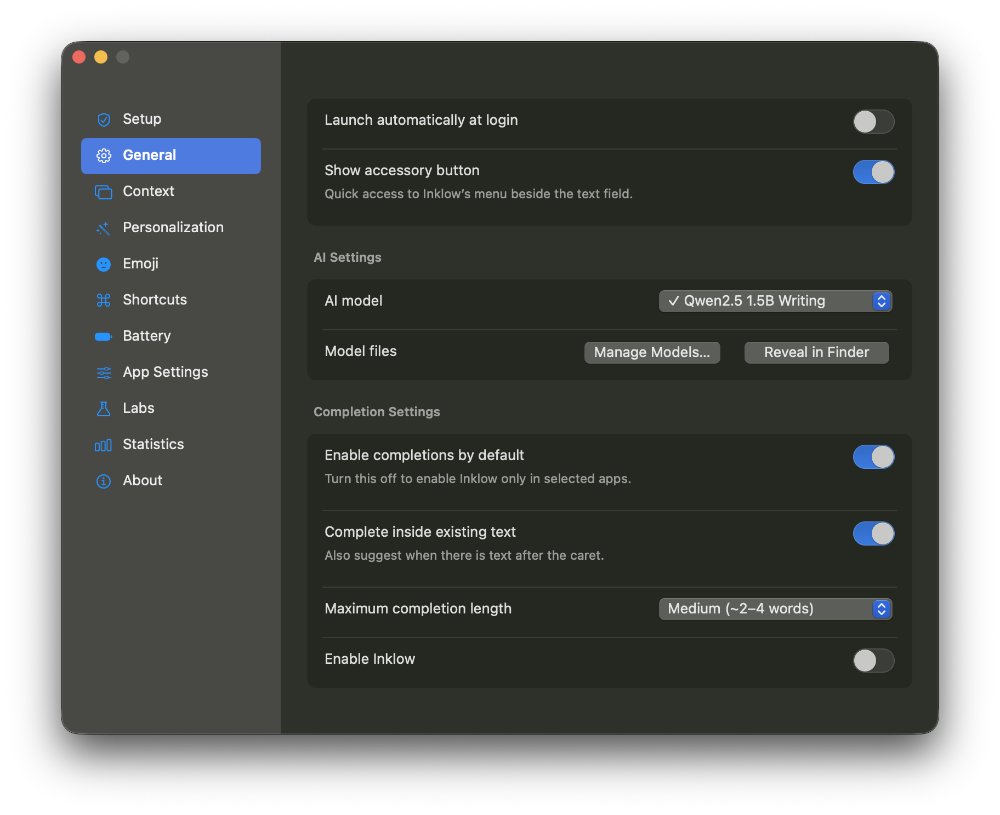

# Inklow

Local-first predictive typing for macOS, Windows, and Linux. Inklow runs in the menu bar or system tray and offers completions in supported applications—there is no separate writing editor.

[Download the latest release](https://github.com/renan-brasilio/inklow/releases/latest) · [All releases](https://github.com/renan-brasilio/inklow/releases) · [Changelog](CHANGELOG.md)



## Install

Download the installer matching your operating system from **Releases → Assets**. This repository is private; you must be signed in to a GitHub account with access to download its releases. Packaged applications include Python and their UI runtime, so Python is not required for installation.

| Platform | Installer | Portable package | Requirements |
| --- | --- | --- | --- |
| macOS, Apple Silicon | `Inklow-<version>-macos-arm64.dmg` | `.zip` | macOS 15 or newer; Apple Silicon |
| Windows, x86-64 | **Pending native verification**; MSI packager available in source | Planned `.zip`, containing the app and CLI EXEs | Windows 10/11; AVX2, FMA, and F16C for bundled local inference |
| Linux, x86-64 | `Inklow-<version>-linux-amd64.deb` | `.tar.gz` | Ubuntu 24.04+/Debian 13+, an X11 desktop and D-Bus; AVX2, FMA, and F16C |

The Windows EXEs are **not standalone files**: keep the entire portable ZIP together. ARM Windows/Linux, Intel macOS, older distributions, and other CPU baselines require a build on the target platform.

Model weights are downloaded separately, only when requested. Installers do not contain models, settings, writing history, or credentials.

The latest prebuilt release is **0.3.0**. The **0.3.1 source hotfix** corrects stale Linux/Windows model-download progress; 0.3.1 installers have not been published. Existing complete model files are reused.

### macOS

1. Open the DMG and drag **Inklow.app** to **Applications**.
2. Launch Inklow from Applications, then open **Setup & Permissions…** from its menu-bar icon.
3. Grant the required permissions described below and select a local model.

The app name stays **Inklow**, without a version suffix. Quit a running copy before replacing it. GitHub-built macOS releases are ad-hoc signed and **not notarized**; they are not Developer ID-signed distributions. Do not disable Gatekeeper globally. Review the source and checksums before deciding whether to allow a downloaded build through macOS security controls.

### Windows

Run the MSI. It installs for the current user and adds an Inklow Start Menu shortcut. For the portable package, extract the full ZIP and run `Inklow.exe`; use `Inklow-cli.exe` for terminal commands.

Windows releases are unsigned unless the release explicitly states otherwise. Windows may show an unrecognized-publisher warning. Do not disable security protections globally.

### Linux

Download the `.deb`, then install the specific file you downloaded:

```sh
sudo apt install ./Inklow-0.3.0-linux-amd64.deb
inklow
```

Run Inklow as your desktop user, **not with sudo**. The published 0.3.0 Debian package installs the application, launcher, desktop entry, and icons, and requires an **X11 session** for typing. Its Wayland restriction includes XWayland applications. The newer source-only KDE path below is not included in that release.

The portable archive must remain intact. Extract it to a writable location and run its `launch-inklow` script. Distribution runtime dependencies and the same CPU/glibc baseline still apply.

#### KDE Wayland — unreleased source candidate

The source now includes a native **KWin input-method-v1** client. It uses the compositor's private input-method connection, not global keyboard injection, a screen-reader identity, or access to raw input devices. This is not universal Wayland support: targets must expose both a compatible text-input protocol and matching editable AT-SPI metadata.

Build on Linux after installing the development dependencies described below:

```sh
.venv/bin/python tools/build_wayland.py
.venv/bin/inklow wayland install
```

The install command adds only Inklow's per-user input-method launcher. Then explicitly select **Inklow** in KDE **System Settings → Keyboard → Virtual Keyboard**, or use **Setup & Permissions…** to open the selector. KDE owns the resulting app launch and its private socket; do not run `--wayland-input-method` directly from a terminal. Selecting an input method lets it receive keyboard events and surrounding text for supported fields, and occupies KDE's input-method slot; consider an existing Fcitx/IBus setup before replacing it. Inklow never selects itself or changes the desktop session automatically.

The exercised target uses **text-input-v3**. Qt applications can request it at their own launch with `QT_WAYLAND_TEXT_INPUT_PROTOCOL=zwp_text_input_v3 QT_IM_MODULE=wayland <application>`. The tested default Qt text-input-v2 path did not provide the required complete context; unobservable or incomplete fields are skipped. This setting is per target application, not a global environment change.

KWin positions the native icon, suggestion, and quick-menu panel near the caret. Exact placement belongs to the compositor; the X11/macOS above-line offset is not a Wayland guarantee. Passwords, selections, stale contexts, and unmatched AT-SPI fields are rejected. Atomic cross-app replacement remains unavailable, so emoji/emoticon rewriting and selected-text synonyms stay disabled. GNOME, wlroots compositors, XWayland targets, and arbitrary third-party applications are not verified by this candidate.


### Verify a download

Every release includes `SHA256SUMS`. Run the checksum command in the directory containing the downloaded assets:

```sh
# Linux
sha256sum --check SHA256SUMS --ignore-missing
# macOS
shasum -a 256 <downloaded-file>
```

On Windows, use `Get-FileHash <downloaded-file> -Algorithm SHA256` in PowerShell. Compare the result with the matching entry in `SHA256SUMS`. A checksum checks file integrity; it is not a code-signing or notarization certificate.

## First run

1. Open **Setup & Permissions…** from the menu bar/system tray.
2. Enable the required OS access for the application you actually launched.
3. In **General → Manage Models…**, explicitly download a writing preset or choose an existing GGUF model.
4. Focus a supported editable input and start typing. Secure fields, password managers, and terminals are excluded by default.

The writing preset in 0.3 is **Qwen2.5 1.5B**, approximately 1.12 GB. The 101 MB Tiny preset is an English starter/testing model, not a comparable writing-quality replacement. Model quality and language coverage vary; suggestions are not a grammar or factuality guarantee.

Models load lazily in a separate process. That process exits after 60 seconds idle by default, and on pause, model change, or Quit. A later request may need a cold load. Locally managed Ollama or OpenAI-compatible servers are also supported through literal loopback URLs; Inklow does not manage those servers' model lifetimes.

### OS permissions

- **macOS:** enable **Device Control and Data Access**—called **Accessibility** on earlier macOS—and **Input Monitoring** in System Settings → Privacy & Security. Grant access to the installed `Inklow.app`, not merely a terminal/Python host. Restart after a change. Screen Recording is optional and needed only for opted-in screen context. Replacing an ad-hoc-signed build can require a fresh manual approval.
- **Windows:** supported controls must expose UI Automation/native Edit capabilities. Elevated applications may require matching integrity privileges; Inklow does not bypass Windows isolation.
- **Linux:** enable desktop accessibility and run within the user's D-Bus session. X11 uses the normal launcher; the unreleased KDE Wayland source path requires explicit input-method selection as described above. Some Qt targets need `QT_LINUX_ACCESSIBILITY_ALWAYS_ON=1` before they start.

Inklow opens the relevant settings pages but never grants permissions automatically.

## Using Inklow

| Action | Default control |
| --- | --- |
| Accept the next word | Tab |
| Accept the complete suggestion | Physical key above Tab |
| Request a suggestion now | Control + physical key above Tab |
| Dismiss and briefly pause | Escape |
| Open pause/settings controls near a field | Click the small Inklow icon above the input line |
| Stop Inklow and its worker | **Quit Inklow** in the menu-bar/tray menu |

Shortcuts, trailing spaces/punctuation, per-app defaults, temporary pauses, and login startup are configurable. Closing Settings leaves Inklow running. Normal application/system shortcuts pass through when no eligible suggestion is active.

Other features include an offline Unicode emoji chooser, contextual synonym/alternative suggestions, optional local context, encrypted opt-in writing history, and aggregate accepted-writing statistics. These are subject to the platform limits below.

## Privacy and saved data

- No account, cloud inference, automatic telemetry, or cloud synchronization is built in. Inference endpoints are restricted to literal loopback addresses; model downloads are the explicit public network operation.
- Clipboard and foreground-screen context are off by default. Screen OCR is macOS-only, uses the eligible foreground window, and does not save screenshots.
- Writing history is off by default. When enabled, it requires AES-GCM encryption and an OS credential store; there is no plaintext fallback.
- Custom instructions are ordinary settings text, not a secret store. Do not put credentials in them.
- Upgrades/uninstallers leave per-user preferences, downloaded models, and history outside the application installation. History and aggregate statistics have separate deletion controls in Settings.
- `INKLOW_HOME` selects an isolated data/settings profile for development. It does not relocate the shared model cache, and isolated profiles cannot change login integration.

A separately managed inference server, OS swap, and OS crash collection have their own privacy behavior outside Inklow's control.

## Platform support

macOS uses native AppKit settings and nonactivating overlays; Qt is not bundled there. Windows/Linux use Qt settings/tray surfaces with native accessibility adapters.

| Capability | macOS | Windows | Linux/X11 |
| --- | --- | --- | --- |
| Supported accessible text inputs | AX | UI Automation/native Edit | AT-SPI Text/EditableText |
| Inline/field-attached suggestions | Yes, when geometry is observable | Yes, when geometry is observable | Yes, when geometry is observable |
| Selected-text/emoji rewriting | Guarded native replacement | Target/control-dependent | Disabled: no cross-app atomic replacement |
| Native-observable website rules | Supported browsers | Unavailable | Unavailable |
| Optional foreground-window OCR | Yes | No | No |

Unsupported, protected, composition-ambiguous, or unobservable fields are skipped. Release install/launch/inference checks do not establish compatibility with every third-party control. Interactive Windows/Linux typing remains a separate verification limit. See the [verification report](evidence/VERIFICATION.md) for exercised scenarios.

## Develop

Use Python 3.12 and [uv](https://docs.astral.sh/uv/). Build on the target OS/architecture; a macOS build cannot produce a Windows runtime.

```sh
git clone git@github.com:renan-brasilio/inklow.git
cd inklow
uv sync --python 3.12 --extra dev --extra local --extra build
uv run inklow doctor
uv run inklow --settings
uv run pytest -q
```

GGUF source builds need Xcode Command Line Tools, Visual Studio C++ Build Tools, or GCC/Clang/CMake. Linux development additionally needs the distribution's AT-SPI/GI bindings and Qt/X11 runtime libraries. Use the distribution Python with `--system-site-packages` when those bindings are supplied by the distribution:

```sh
/usr/bin/python3 -m venv --system-site-packages .venv
.venv/bin/python -m pip install -e '.[dev,local,build]'
```

Download a model explicitly with `inklow model download`; use `--no-select` to leave the selected model unchanged. A source launch may inherit its terminal host's permissions and is not proof that a separately installed app has access.

### Build applications and installers

```sh
uv run inklow model download --preset tiny
uv run python tools/build_app.py
uv run python tools/smoke_bundle.py
# Run the command matching the build host:
uv run python tools/package_macos.py --bundle dist/Inklow.app --output release --version 0.3.1
uv run python tools/package_windows.py --bundle dist/Inklow --output release --version 0.3.1
uv run python tools/package_linux.py --bundle dist/Inklow --output release --version 0.3.1
```

The example explicitly selects `tiny` for the inference smoke. Set `INKLOW_HOME` to a disposable profile directory for **all** these commands if you want to preserve your normal model selection; `--no-select` downloads weights but does not configure the smoke worker.

The packagers consume a complete native build; they do not cross-compile. macOS uses `hdiutil`/`ditto`, Windows uses WiX, and Linux uses `dpkg-deb`. The workflow installs their build-only prerequisites and exercises the resulting installers.

Windows installer builds additionally require .NET SDK 8 and the pinned WiX tool:

```powershell
dotnet tool install --global wix --version 5.0.2
```

For Linux builds, install `dpkg-dev`, `python3-gi`, `python3-pyatspi`, `gir1.2-atspi-2.0`, `gir1.2-glib-2.0`, and `libgtk-3-0t64` alongside the desktop libraries. The native Wayland client additionally requires a C compiler, `pkg-config`, `libwayland-dev`, `libxkbcommon-dev`, `wayland-protocols`, and `wayland-scanner` (usually supplied by `libwayland-bin`); source development can build it with `python tools/build_wayland.py`, and the Linux application build invokes that helper automatically. GTK is needed to resolve the bundled Qt native-theme plugin's ELF dependencies even on a minimal X11 build host. Build with CPython 3.12 on Ubuntu 24.04 so the distro GI extension ABI matches. The [CI workflow](.github/workflows/ci.yml) lists the complete build prerequisites. Packaged Linux applications include the Python bindings; end users do not need Python packages.

For stable local macOS signing, supply the same existing Keychain identity on each build:

```sh
INKLOW_CODESIGN_IDENTITY='<identity name or fingerprint>' uv run python tools/build_app.py --replace
```

Never commit or export signing keys into the repository. Local certificate signing does not imply Developer ID distribution or notarization.

### Release workflow

GitHub Actions checks regressions, launches actual settings, runs source/frozen inference, builds native packages, and exercises installer installation/mount and removal. Release assets are published only after every native job succeeds. The publication step creates a versioned GitHub Release, portable packages, a manifest, and SHA-256 checksums from the verified files.

To publish, update the version in `pyproject.toml` and `src/inklow/__init__.py`, commit the source, then run **Actions → Cross-platform checks → Run workflow** with `release_tag` set to the matching `v<version>`. An empty input runs checks only. Pushing a matching version tag also publishes after verification. Existing tags/releases are never overwritten.

For Git-only publication without API workflow-dispatch access, push the committed release source to `release/<version>` (for example, `git push origin HEAD:refs/heads/release/0.3.1`). This explicitly requests a release; the workflow creates the matching version tag only after every platform passes. Use a new version after an already-published release.

Self-hosted/manual releases use the same `tools/package_<platform>.py` and `tools/smoke_<platform>_*` checks on disposable native desktops. Windows verification requires an interactive Windows user session; Wine or a CLI version check is not a substitute. Linux installer smoke requires passwordless sudo **inside the disposable test environment**, X11/Xvfb and a private D-Bus session.

After all checks for a target pass, seal its two native files with `tools/release_assets.py manifest --assets <target-directory> --target <target> --commit <full-source-sha> --receipt <native-smoke.json>`. Keep one target directory per platform under a common input directory. `publish --inputs <directory> --output <new-directory> --tag v<version> --commit <full-source-sha> --repo renan-brasilio/inklow` verifies the transferred files before draft-first publication.

The publisher defaults to **all three targets**. An intentionally reduced release must explicitly pass `--targets` and lists omitted targets in its release notes and manifest; missing/failed native checks never silently become a partial release. Windows installer publication is currently deferred pending its native runtime checks.

The initial installer release uses the verified 0.3 code line. Unfinished model/prompt experiments are not silently included in release binaries. See workflow inputs and release notes for the exact source revision.

### Source layout

- `runtime.py`, `core.py`: controller, snapshots, acceptance guards.
- `process_client.py`, `process_worker.py`: isolated inference worker and lifecycle.
- `providers.py`, `writing.py`, `models.py`: local backends, prompts, pinned downloads.
- `appkit_ui.py`, `qt_ui.py`, `native/`: platform interfaces and accessibility adapters.
- `storage.py`, `config.py`, `system.py`: local data, preferences, explicit OS integration.
- `tools/`, `packaging/`, `.github/workflows/`: development checks, native packaging, releases.

## References and attribution

[Implementation verification](evidence/VERIFICATION.md) · [Reference-app research](evidence/COTYPIST.md)

Inklow does not contain Cotypist's proprietary code, models, or assets. The bundled emoji catalogue retains its Unicode license; third-party runtimes/models retain their own licenses. No model weights are committed to the repository or included in installers.
